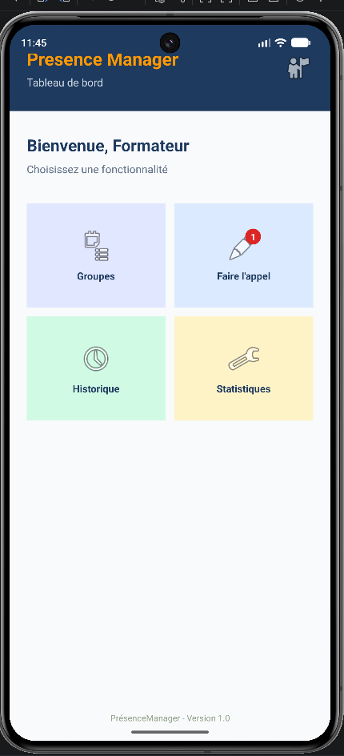

#presenceManager
presenceManager is an android application developed in kotlin and XML

## TP02 : Tableau de bord (Dashboard)
* Création de l'interface du tableau de bord (DashboardActivity) utilisant ConstraintLayout, RelativeLayout, GridLayout et FrameLayout pour structurer les fonctionnalités (Groupes, Faire l'appel, Historique, Statistiques) avec un badge de notification.
* 

## TP03 : Navigation et Gestion des Activités
Mise en place de la navigation interactive à partir du tableau de bord (`DashboardActivity`) vers les différents modules de l'application via des Intents explicites :
- **GroupesActivity** : Gestion des groupes.
- **AppelActivity** : Interface de pointage des présences.
- **HistoriqueActivity** : Consultation des registres.
- **StatistiquesActivity** : Affichage des rapports.
